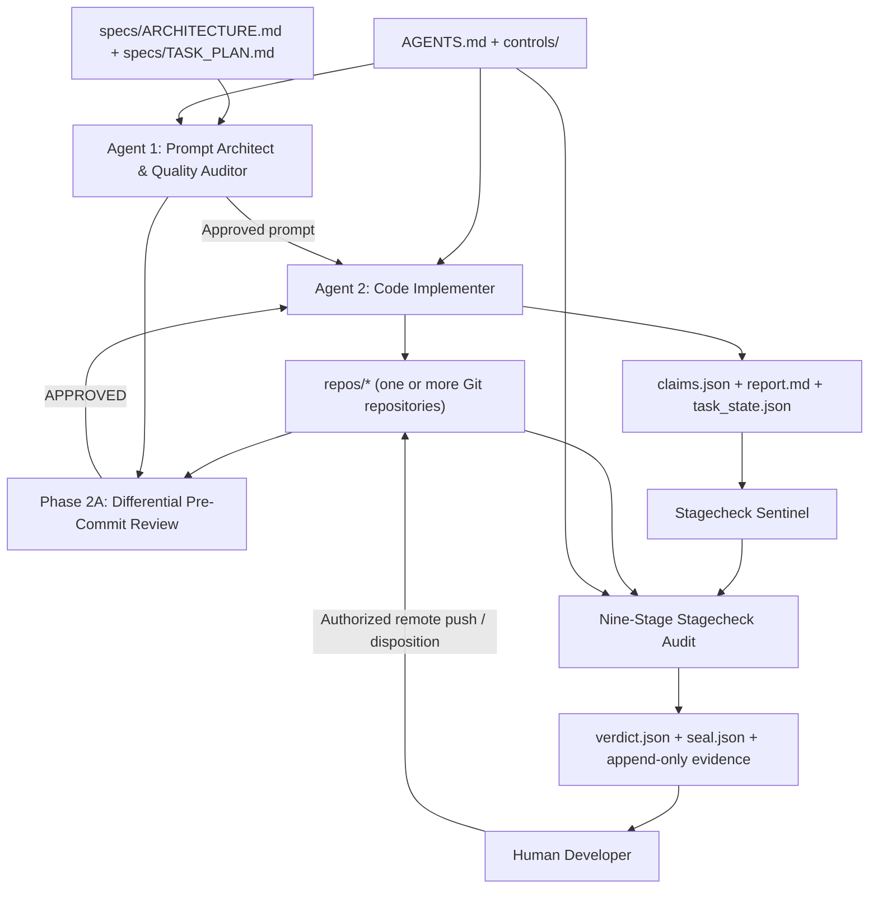
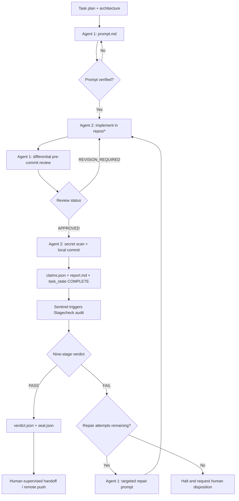

# Stagecheck 🛡️

**Independent, Provider-Agnostic Governance and Verification Engine for AI-Assisted Software Engineering**


Stagecheck is an independent, non-intrusive verification and governance system for software work performed by autonomous or pair-programmed AI coding agents. It coordinates task planning, implementation review, repository-boundary enforcement, reproducible testing, defect carry-forward, and cryptographic evidence sealing.

Stagecheck is designed to work with different coding agents, IDEs, and CLI tools. Its verification engine is separated from both the product repositories and the human-owned governance controls.

The system is built around two cooperating agent roles:

- **Agent 1 — Prompt Architect & Quality Auditor:** decomposes requirements, prepares architecture-driven implementation prompts and test specifications, reviews uncommitted changes, and diagnoses audit failures. Agent 1 does not modify product source code.
- **Agent 2 — Code Implementer:** implements approved work in product repositories, runs authorized tests, commits locally, and prepares claims and delivery records. Agent 2 does not modify governance controls and does not push to a remote.

Stagecheck supplies the deterministic gates and evidence needed for a human-supervised delivery process. It does not replace the human owner's authority over governance, dispositions, or remote publication.

---

## Contents

1. [Core Architecture](#1-core-architecture)
2. [Programme Workspace](#2-programme-workspace)
3. [Governance Controls](#3-governance-controls)
4. [Agent Responsibilities](#4-agent-responsibilities)
5. [End-to-End Task Lifecycle](#5-end-to-end-task-lifecycle)
6. [Pre-Commit Differential Review](#6-pre-commit-differential-review)
7. [Nine-Stage Verification Pipeline](#7-nine-stage-verification-pipeline)
8. [Git and Branch Discipline](#8-git-and-branch-discipline)
9. [CLI Usage](#9-cli-usage)
10. [Evidence and Cryptographic Sealing](#10-evidence-and-cryptographic-sealing)
11. [Sentinel and Guardrails](#11-sentinel-and-guardrails)
12. [Configuration and Toolchain Layout](#12-configuration-and-toolchain-layout)
13. [Implementation Roadmap](#13-implementation-roadmap)
14. [License](#14-license)

---

## 1. Core Architecture

Stagecheck separates the programme workspace into independent domains:

- **Governance:** human-authorized controls and the root `AGENTS.md` contract.
- **Specifications:** the baseline architecture, task plan, and starting manifest.
- **Product repositories:** one or more Git repositories containing the software being changed.
- **Evidence:** append-only task attempts, reviews, audit verdicts, and cryptographic seals.
- **Verification toolchain:** the Stagecheck CLI, sentinel, checks, configuration, and integrity manifest.
- **Agent instructions:** canonical instructions defining each agent's responsibilities and restrictions.

The programme workspace does not contain the Stagecheck toolchain. Its installation is external to the workspace and is resolved through `controls/STAGECHECK_ROOT.json`. Product code, governance controls, evidence, agent instructions, and the verifier therefore retain separate trust boundaries.

### High-level flow



### Architectural invariants

1. `stagecheck/` is not a product repository and must never be modified by either AI agent.
2. Agents may work only within repository paths and commands authorized by the programme contract and controls.
3. Agent 2 commits locally only after Agent 1 records an `APPROVED` pre-commit review.
4. AI agents never push to a remote repository.
5. Each task attempt has its own evidence directory. Earlier attempts are retained and are not overwritten.
6. A task is complete only after formal Stagecheck verification and the required human-supervised handoff.

---

## 2. Programme Workspace

The canonical programme workspace is rooted at `/home/developer/workspace/`. It contains the governance contract, human-owned controls, baseline specifications, append-only task evidence, product repositories, and the two canonical agent instruction files.

The Stagecheck toolchain is **not a child directory of the programme workspace**. Its installation path and manifest digest are bound by `controls/STAGECHECK_ROOT.json`.

```text
/home/developer/workspace/                   <-- Programme Root (<root>)
├── AGENTS.md                                <-- 1. Main Contract & 7-Row Binding Table
│
├── controls/                                <-- 2. Control Descriptors Folder (Human-Authorized)
│   ├── STAGECHECK_ROOT.json                 <-- Binds Stagecheck tool directory & manifest hash
│   ├── EVIDENCE_ROOT.json                   <-- Directs where task evidence & seals are stored
│   ├── PRODUCT_REPOSITORIES.json            <-- Declares target git code repositories (default_branch: Development)
│   ├── QUALIFICATION_ROOT.json              <-- Qualification test artifacts folder
│   ├── ACTIVE_STATE.json                    <-- Project state machine pointer
│   ├── OWNER_GRANTS.md                      <-- Human-authorized command execution grant
│   ├── FAILURE_PREVENTION.md                <-- Failure prevention register
│   └── DISPOSITIONS.json                    <-- Human disposition & override ledger (Spec 13)
│
├── specs/                                   <-- 3. Baseline Architecture & Plans (auto-ingested from Docs/)
│   ├── START_MANIFEST.md                    <-- Approved baseline file checksum table
│   ├── TASK_PLAN.md                         <-- Milestone & execution plan document
│   └── ARCHITECTURE.md                      <-- Target architecture specification
│
├── evidence/                                <-- 4. Immutable Evidence Root (Append-Only)
│   └── tasks/                               <-- Task-specific audit history
│       └── <task_id>/                       <-- e.g., TASK-01/
│           ├── attempt_1/                   <-- Attempt 1 (Preserved forever, never overwritten)
│           │   │
│           │   ├── [Phase 1: Pre-Code Gate (Planning)]
│           │   │   ├── prompt.md            <-- 1. Written by Agent 1 (Task blueprint & test specs)
│           │   │   └── prompt_verified.json <-- 2. Generated by Stagecheck (Approves prompt before coding)
│           │   │
│           │   ├── [Phase 2A: Pre-Commit Cooperative Review (Working Tree)]
│           │   │   └── pre_commit_review.json <-- 3. Written by Agent 1 (Differential audit on uncommitted code: APPROVED)
│           │   │
│           │   ├── [Phase 2B: Post-Commit Deliverables (Stagecheck Trigger)]
│           │   │   ├── claims.json          <-- 4. Written by Agent 2 (Git commits & cited test runs)
│           │   │   ├── report.md            <-- 5. Written by Agent 2 (Delivery markdown summary)
│           │   │   └── task_state.json      <-- 6. Written by Agent 2 (status: COMPLETE, triggers audit)
│           │   │
│           │   └── [Phase 3: Post-Audit Gate (Stagecheck Verification)]
│           │       ├── verdict.json         <-- 7. Generated by Stagecheck (9-stage audit findings: PASS/FAIL)
│           │       └── seal.json            <-- 8. Generated by Stagecheck (Cryptographic seal of attempt)
│           │
│           ├── attempt_2/                   <-- Attempt 2 (Created only on failure repair)
│           │   │
│           │   ├── [Phase 1: Pre-Code Repair]
│           │   │   ├── repair_prompt.md     <-- 1. Written by Agent 1 (Targeted fix prompt & test specs)
│           │   │   └── prompt_verified.json <-- 2. Generated by Stagecheck (Approves fix prompt)
│           │   │
│           │   ├── [Phase 2A: Pre-Commit Cooperative Review (Working Tree)]
│           │   │   └── pre_commit_review.json <-- 3. Written by Agent 1 (Differential audit on uncommitted fix: APPROVED)
│           │   │
│           │   ├── [Phase 2B: Post-Commit Repair Deliverables]
│           │   │   ├── claims.json          <-- 4. Written by Agent 2 (Repair git commits & test runs)
│           │   │   ├── report.md            <-- 5. Written by Agent 2 (Repair deliverable report)
│           │   │   └── task_state.json      <-- 6. Written by Agent 2 (status: COMPLETE, triggers audit)
│           │   │
│           │   └── [Phase 3: Post-Audit Repair]
│           │       ├── verdict.json         <-- 7. Generated by Stagecheck (9-stage audit findings: PASS)
│           │       └── seal.json            <-- 8. Generated by Stagecheck (Chained to attempt 1 seal)
│           │
│           └── seal.json                    <-- Master task seal (Created on final PASS)
│
├── repos/                                   <-- 5. Multi-Repo Directory (Code repositories, default_branch: Development)
│   └── my-project/
│       └── .git/
│
├── instructions/                            <-- 6. Agent Role Instructions (Strictly 2 files; zero duplicate generic files)
│   ├── <agent1>_prompt_and_audit.md         <-- Instructions for Agent 1 (Prompt & Audit)
│   └── <agent2>_code_implementation.md      <-- Instructions for Agent 2 (Code Implementer)
```

Repository entries under `repos/` are declared in `controls/PRODUCT_REPOSITORIES.json`; the example `my-project/` directory can be replaced by one or more configured repositories. The `Development` branch is the configured default, while task work is performed on isolated task branches.

### Evidence attempt contents

Each attempt preserves the artifacts produced at each lifecycle gate:

| Phase | Artifact | Written by | Purpose |
|---|---|---|---|
| Phase 1 | `prompt.md` / `repair_prompt.md` | Agent 1 | Task blueprint or targeted repair prompt and test specifications |
| Phase 1 | `prompt_verified.json` | Stagecheck | Records prompt-gate verification |
| Phase 2A | `pre_commit_review.json` | Agent 1 | Records differential working-tree review and approval status |
| Phase 2B | `claims.json` | Agent 2 | Structured evidence and command/test records |
| Phase 2B | `report.md` | Agent 2 | Human-readable delivery report |
| Phase 2B | `task_state.json` | Agent 2 | Signals that deliverables are complete and ready for audit |
| Phase 3 | `verdict.json` | Stagecheck | Formal audit outcome and findings |
| Phase 3 | `seal.json` | Stagecheck | Cryptographic seal for the attempt |

A task-level `seal.json` is created after the task reaches its required successful state. Earlier attempt directories remain preserved for audit and carry-forward verification.

---

## 3. Governance Controls

The `controls/` directory contains human-authorized governance descriptors. Neither Agent 1 nor Agent 2 is permitted to edit these files.

| Control | Responsibility |
|---|---|
| `STAGECHECK_ROOT.json` | Binds the active Stagecheck installation path and its `MANIFEST.sha256` digest. |
| `EVIDENCE_ROOT.json` | Defines the location used for task evidence and audit history. |
| `PRODUCT_REPOSITORIES.json` | Declares the product repositories, relative paths, upstream references, primary repository, and clean-state requirements. Schema version 2 supports multi-repository work. |
| `QUALIFICATION_ROOT.json` | Points to independent qualification suites, gas benchmarks, and integration tests. |
| `ACTIVE_STATE.json` | Tracks the active milestone, current task, completed tasks, evidence references, and open prerequisites. |
| `OWNER_GRANTS.md` | Whitelists human-authorized commands that Agent 2 and Stagecheck may execute. |
| `FAILURE_PREVENTION.md` | Records historical failure modes and required regression-prevention checks. |
| `DISPOSITIONS.json` | Records human-authorized exceptions or accepted deviations with their scope, reason, authorizer, and timestamp. |

### `AGENTS.md` programme contract

`AGENTS.md` is the root governance contract. It defines:

- The active programme root and governing architecture.
- The seven-row SHA-256 governance binding table.
- Agent roles, allowed paths, and prohibited actions.
- The execution lifecycle and Stagecheck readiness triggers.

Stagecheck validates the control bindings during the `authority` stage. A binding mismatch is an authority violation and halts the audit. The contract also explicitly prohibits agents from modifying `stagecheck/`.

The control files and their hashes are owned and updated through the human governance process, not by an AI agent during task implementation.

---

## 4. Agent Responsibilities

### Agent 1 — Prompt Architect & Quality Auditor

Agent 1 is responsible for planning and independent review, not implementation.

- Decomposes task requirements against `specs/ARCHITECTURE.md` and `specs/TASK_PLAN.md`.
- Creates the task prompt and architecture-driven test specifications.
- Checks the prompt through the Phase 1 gate.
- Reviews Agent 2's uncommitted changes against the captured baseline.
- Classifies pre-existing debt, approved architectural intent, and newly introduced defects.
- Writes `pre_commit_review.json` and must record `APPROVED` before Agent 2 commits.
- Diagnoses formal audit failures and prepares targeted repair prompts.

**Restriction:** Agent 1 never modifies product source code.

### Agent 2 — Code Implementer

Agent 2 performs the approved implementation.

- Implements the task and its tests in authorized `repos/*` repositories.
- Runs only commands permitted by `controls/OWNER_GRANTS.md`.
- Performs a local secret scan before committing.
- Waits for Agent 1's `APPROVED` pre-commit review.
- Creates local Git commits using the required commit format.
- Generates `claims.json`, `report.md`, and `task_state.json`.

**Restrictions:** Agent 2 never edits `controls/`, never modifies `stagecheck/`, and never pushes to a remote repository.

### Provider-agnostic integration

The architecture is not tied to one AI vendor or coding environment. It identifies compatibility with Claude Code, Gemini CLI, Cursor, Codex, OpenCode, Aider, and local models. Agent integration is mediated through the role instructions, task artifacts, and Stagecheck gates.

---

## 5. End-to-End Task Lifecycle

A task proceeds through four phases, with Phase 2 split into two gates.

### Phase 1 — Pre-Code Planning Gate

1. Agent 1 reads the task plan and governing architecture.
2. Agent 1 writes `prompt.md`, including implementation scope and test specifications.
3. Stagecheck verifies prompt structure, scope, and applicable failure-prevention requirements.
4. If invalid, Agent 1 revises the prompt.
5. If valid, Stagecheck generates `prompt_verified.json`.

Agent 2 must not begin implementation until the prompt gate is approved.

### Phase 2A — Pre-Commit Cooperative Review

1. Agent 2 implements the approved task in the working tree and runs authorized local tests.
2. Agent 1 captures and reviews the Git diff against the task's recorded `base_commit`.
3. Agent 1 checks the changes against the architecture and classifies findings.
4. Agent 1 writes `pre_commit_review.json`.
5. If the review is `REVISION_REQUIRED`, Agent 2 fixes the working tree and the review cycle repeats.
6. If the review is `APPROVED`, Agent 2 may proceed to Phase 2B.

No task commit is created before the review status is `APPROVED`.

### Phase 2B — Commit and Delivery Preparation

1. Agent 2 runs the local secret scan.
2. Agent 2 commits the approved changes locally.
3. Agent 2 writes `claims.json` and `report.md`.
4. Agent 2 writes `task_state.json` with `status: COMPLETE`.

Agent 2 does not push the commit to a remote.

### Phase 3 — Formal Audit and Sealing

1. The Stagecheck Sentinel detects the completed task state.
2. Stagecheck runs the nine-stage audit against the committed repository state and configured controls.
3. On `PASS`, Stagecheck writes the verdict and cryptographic seal, and the task can proceed to the supervised handoff.
4. On `FAIL`, Stagecheck records the defects. Agent 1 prepares a targeted repair prompt for the next attempt, subject to the circuit breaker.
5. The human developer reviews the certified result and performs any authorized remote push.



---

## 6. Pre-Commit Differential Review

The pre-commit review prevents avoidable formal repair attempts and distinguishes newly introduced defects from existing repository debt.

### Baseline and comparison

At task start, Agent 1 records the repository's `base_commit`. The review evaluates the task changes relative to that baseline, rather than treating every issue in the repository as newly introduced.

### Finding classifications

| Classification | Meaning | Treatment |
|---|---|---|
| `pre_existing_issues_ignored` | Issues already present at `base_commit`, such as legacy warnings or historical test failures. | Catalogued as pre-existing; not attributed to the task. |
| `architectural_intents_approved` | Structural or interface changes required by the governing architecture. | Recorded as intentional and approved when consistent with the architecture. |
| `new_issues_found` | Regressions, missing tests, unhandled error cases, or architecture/contract violations introduced by the task. | Requires remediation before approval. |

New findings include a root-cause explanation (`why`) and a recommended correction (`remedy`).

### Review handshake

The review is stored at:

```text
evidence/tasks/<task_id>/attempt_<N>/pre_commit_review.json
```

Agent 2 is prohibited from committing until the review status is exactly `APPROVED`. This review is a separate cooperative gate; it does not replace the formal nine-stage Stagecheck audit.

---

## 7. Nine-Stage Verification Pipeline

When the Sentinel observes `task_state.json` with `status: COMPLETE`, Stagecheck runs the following stages:

| Stage | Check | Verification purpose | Example failure condition |
|---:|---|---|---|
| 1 | `preflight` | Validates required deliverables, schemas, lock files, and environment readiness. | Missing or malformed required artifacts; invalid state. |
| 2 | `scope_paths` | Checks changed paths against repository declarations and approved task scope. | Modification outside authorized repository paths. |
| 3 | `citations` | Verifies cited command and test output using recorded stdout/stderr SHA-256 digests. | Missing, altered, or unsupported command evidence. |
| 4 | `report_lint` | Checks report structure, heading hierarchy, and parity with claims. | Malformed or incomplete delivery report. |
| 5 | `authority` | Verifies governance bindings and control-file integrity. | Unauthorized control modification or hash mismatch. |
| 6 | `secrets` | Scans relevant staged and committed changes for credentials and sensitive material. | Private keys, tokens, passwords, or other detected secrets. |
| 7 | `qual_naming` | Enforces qualification test naming conventions. | Tests do not follow the required naming convention. |
| 8 | `rerun` | Independently reruns cited tests in isolated working directories with timeouts. | Test failure or non-reproducible result. |
| 9 | `carry_forward` | Verifies defect continuity and cryptographic linkage across task attempts. | Reappearing unresolved defects or broken attempt-seal chain. |

The pipeline is fail-closed: a blocking failure prevents a successful certification. Human-authorized exceptions must be represented through the disposition governance mechanism rather than silently ignored.

---

## 8. Git and Branch Discipline

Stagecheck preserves an auditable local Git history.

### Branch protection

- The configured default active branch is `Development`.
- Direct work and commits to `Development`, `main`, or `master` are prohibited.
- Agent work is performed on isolated branches named `task/<task_id>`.
- Phase 2A and Phase 3 both enforce protected-branch rules.

### Commit message format

**Initial task commits:**

```text
T<TASK_NUM> [SCOPE]: <imperative action description>
```

Example:

```text
T01 [AUTH]: implement token validation handler
```

**Repair commits:**

```text
RT-<TASK_NUM> [DEFECT_IDS]: repair <summary of fix>
```

Example:

```text
RT-01 [DEF-01,DEF-02]: repair mutex data race in session store
```

### Immutable history

AI agents must not use `git commit --amend`, `git reset`, or `git rebase` as routine workflow operations. Rewriting a previously sealed commit would invalidate the audit history and attempt linkage.

Repair attempts are layered on top of prior attempts. The architecture identifies accidental secret leakage detected before sealing as the exceptional case requiring controlled history cleanup.

### Remote push policy

Agent 2 has no remote-push responsibility. Remote push is reserved for the human developer or an explicitly authorized CI process after Stagecheck certification and human review.

### Multi-repository tracking

`PRODUCT_REPOSITORIES.json` schema version 2 declares the repositories participating in a programme. Stagecheck tracks the checked repository heads through `checked_heads`, allowing a task to be evaluated across a multi-repository change set.

---

## 9. CLI Usage

The architecture defines a unified `stagecheck` CLI.

### Initialize a programme workspace

```bash
stagecheck init --workspace ./workspace --docs ./Docs --agents 2
```

The initialization workflow scaffolds the programme workspace and can ingest architecture and task-plan Markdown documents from `Docs/` or `docs/` into `specs/`.

### Start the background Sentinel

```bash
stagecheck sentinel --workspace ./workspace --notify desktop
```

### Verify a task prompt

```bash
stagecheck verify-prompt --task TASK-01 --attempt 1
```

### Run the formal audit

```bash
stagecheck audit --task TASK-01 --attempt 1
```

### Re-seal the toolchain manifest

```bash
stagecheck seal --update-manifest
```

These commands reflect the finalized architecture's CLI interface. Paths, repository names, and control values are installation-specific and must be configured in the workspace.

---

## 10. Evidence and Cryptographic Sealing

Stagecheck retains task attempts under the configured evidence root:

```text
evidence/
└── tasks/
    └── <task_id>/
        ├── attempt_1/
        │   ├── prompt.md
        │   ├── prompt_verified.json
        │   ├── pre_commit_review.json
        │   ├── claims.json
        │   ├── report.md
        │   ├── task_state.json
        │   ├── verdict.json
        │   └── seal.json
        ├── attempt_2/
        │   └── ...
        └── seal.json
```

Each attempt is preserved. A later repair attempt does not overwrite the evidence from an earlier attempt.

The architecture uses SHA-256 digests and Git Merkle tree digests to bind toolchain integrity and task evidence. The attempt seal links the formal result to its evidence; subsequent attempts are chained to prior seals. The task-level seal represents the final task certification.

### Toolchain integrity

`stagecheck/MANIFEST.sha256` records the integrity state of the Stagecheck toolchain. The root control descriptor binds the installation path and manifest digest. Changes to the toolchain require the authorized sealing workflow; agents must not edit the toolchain.

---

## 11. Sentinel and Guardrails

### Background Sentinel

The Stagecheck Sentinel monitors the workspace for lifecycle events, including the task completion signal. The architecture specifies Linux `inotify` and `select.epoll` for background monitoring, with desktop notifications and terminal output for audit outcomes and escalations.

Its boundary-monitoring policy is organized into three tiers:

- **Tier 1 — Hard Block:** protects `controls/`, `AGENTS.md`, and `specs/` from unauthorized agent modifications.
- **Tier 2 — Noise Filter:** suppresses irrelevant events from locations such as `.git/`, `.cache/`, and vendor trees.
- **Tier 3 — Prompt Whitelist:** checks modifications against the authorized path policy.

### Repair circuit breaker

A task is limited to a maximum of three attempts (`attempt_1`, `attempt_2`, and `attempt_3`). If the final permitted attempt fails, the Sentinel halts the loop and notifies the human developer for disposition.

### Stagnation and regression detection

The Sentinel can halt early when a subsequent attempt produces the same defect fingerprint as the previous attempt, or when a previously passing stage regresses to failure.

### Human dispositions

`controls/DISPOSITIONS.json` is the human-authorized ledger for accepted technical debt or intentional deviations. A disposition must identify the task, target repository, relevant stage or defect pattern, reason, authorizer, and timestamp. It preserves an explicit record of the exception rather than hiding or deleting a finding.

---

## 12. Configuration and Toolchain Layout

The Stagecheck installation is located under `stagecheck/` and is separated from product repositories.

```text
stagecheck/
├── bin/
│   ├── stagecheck
│   ├── stagecheck_sentinel.py
│   ├── orchestrate.py
│   ├── verify_prompt.py
│   ├── seal_tool.py
│   └── internal/
│       ├── verify_manifest.py
│       └── verify_state_chain.py
├── checks/
│   ├── preflight.py
│   ├── scope_paths.py
│   ├── citations.py
│   ├── report_lint.py
│   ├── authority.py
│   ├── secrets.py
│   ├── qual_naming.py
│   ├── rerun.py
│   └── carry_forward.py
├── config/
│   ├── agents.json
│   ├── commands.json
│   ├── depth.json
│   └── quality_targets.json
├── evals/
│   ├── fixtures.py
│   ├── run_evals.py
│   ├── test_quality.py
│   └── test_response.py
├── MANIFEST.sha256
└── pyproject.toml
```

Key configuration responsibilities:

| File | Responsibility |
|---|---|
| `config/agents.json` | Agent identity validation and normalization rules. |
| `config/commands.json` | Portable command registry and execution grants, using workspace/repository tokens such as `{REPO_ROOT}` and `{TOOLCHAIN_BIN}`. |
| `config/depth.json` | Sensitive-path evaluation rules, including paths requiring elevated scrutiny. |
| `config/quality_targets.json` | Statistical quality thresholds used by the evaluation and promotion process. |

Other workspace-level policy and authorization live in `controls/`, not in the toolchain configuration.

---

## 13. Implementation Roadmap

The finalized architecture groups implementation into four phases:

- [x] **Phase 1 — Internalization, Decoupling & Manifest Re-Sealing**
  - Internalized verification utilities under `stagecheck/bin/internal/`.
  - Replaced machine-specific command paths with portable workspace tokens.
  - Added the toolchain sealing utility and regenerated the integrity manifest.

- [x] **Phase 2 — Universal Agent Support & Self-Contained Evaluations**
  - Added dynamic agent identity validation and normalization.
  - Removed hardcoded paths from evaluation tooling.
  - Added reusable in-memory evaluation fixtures.

- [x] **Phase 3 — Multi-Repository, Pre-Commit Review & Governance**
  - Added `PRODUCT_REPOSITORIES.json` schema v2 and `checked_heads` support.
  - Added the Phase 2A differential pre-commit review evaluator.
  - Added human disposition evaluation and repair circuit-breaker logic.

- [x] **Phase 4 — Packaging, Scaffolding & Sentinel**
  - Added the unified CLI and workspace scaffolding workflow.
  - Added the background Sentinel and desktop notifications.
  - Consolidated setup and initialization entrypoints.

The architecture also records post-implementation refinements for dynamic Git remote owner extraction, protected branches, automated document ingestion, instruction-file cleanup, toolchain protection, governance-contract structure, and terminal status banners.

---

## 14. License

This project is licensed under the [MIT License](LICENSE).
