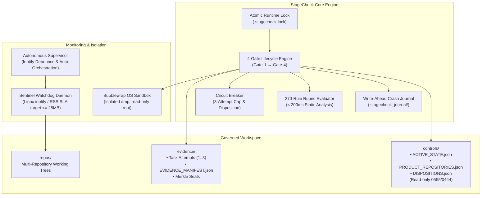
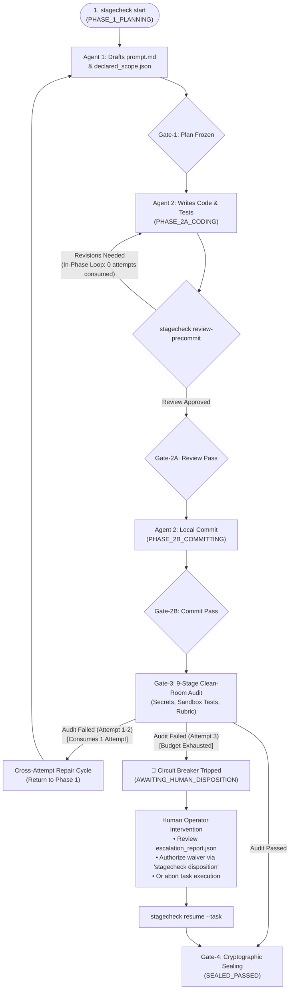
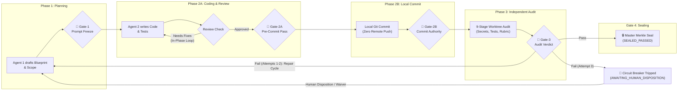
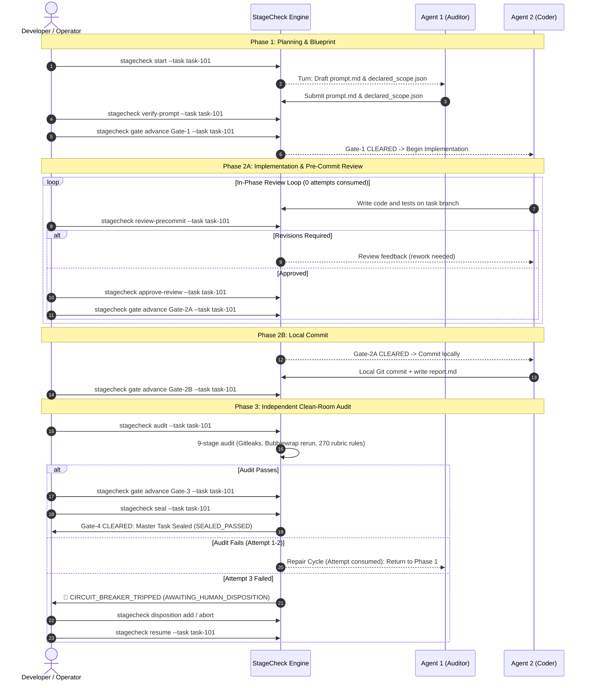
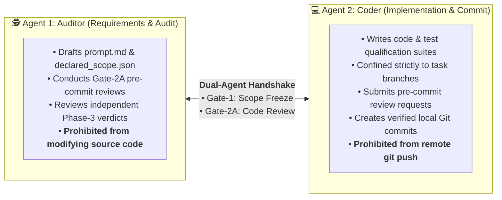
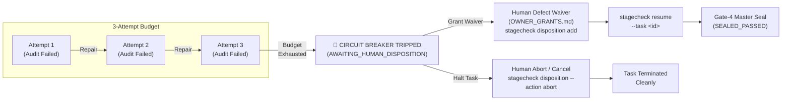

# 🛡️ StageCheck

**Deterministic AI Software Delivery Governance & Multi-Agent Verification (`v2.0.0`)**

---

## 📌 1. What is StageCheck?

**StageCheck** is a lightweight, fail-closed governance tool designed for autonomous AI coding agents (such as Claude Code, Codex, Gemini, and custom agent harnesses).

When AI agents work on software codebases, they risk modifying unauthorized files, skipping tests, leaking credentials, drifting from architectural blueprints, or burning API tokens in unconstrained repair loops. StageCheck acts as an automated, impartial supervisor: it confines agents to a declared project scope, enforces immutable quality gates between planning and delivery, scans for secrets, re-runs tests inside an isolated OS sandbox, and cryptographically seals verified work.

---

## 🎯 2. What is the Use of StageCheck? (Purpose & Core Capabilities)

* **Strict Scope Containment:** Enforces declared boundaries from `declared_scope.json`. Agents cannot touch unauthorized files or escape into parent directories.
* **Separation of Duties (Dual-Agent Protocol):**
  * **Agent 1 (Auditor):** Authoritative for blueprint drafting, requirements specification, and pre-commit review auditing.
  * **Agent 2 (Coder):** Strictly confined to implementing code and tests on task-specific branches with zero remote push access.
* **Secret Leak Prevention:** Automatically scans all git diffs and repository assets for hardcoded passwords and API keys using Gitleaks and Python AST analysis before commits occur.
* **Sandboxed Clean-Room Test Verification:** Re-runs test suites inside an isolated Bubblewrap OS sandbox with read-only host mounts and private tmpfs to guarantee genuine test results.
* **Deterministic Rubric Evaluation:** Statically evaluates 270 comprehensive rules across security, quality, architecture, and documentation in $< 200\text{ ms}$.
* **Monotonic Attempt Budgeting (Circuit Breaker):** Caps task audit failures at exactly 3 attempts. When exhausted, execution halts immediately into `AWAITING_HUMAN_DISPOSITION` to protect token budgets.
* **Cryptographic Evidence Sealing:** Uses deterministic SHA-256 Merkle DAG calculations to freeze all task deliverables, audit receipts, and verification records into `EVIDENCE_MANIFEST.json`.
* **Zero Python Runtime Dependencies:** Built 100% on the Python standard library (`dependencies = []`), operating entirely in user-space without `root` or `sudo` privileges.

---

## 🏗️ 3. Architecture Diagram

The diagram below illustrates the core components of StageCheck and how they protect the workspace:

<div align="center">



</div>

---

## 🔄 4. Flowchart (Lifecycle & Phase Gates)

StageCheck enforces a sequential 4-gate pipeline from planning to final cryptographic seal:

> [!NOTE]
> **Understanding the Four Gates vs. Five Checkpoints:**  
> StageCheck enforces a **4-Gate model** matching its 4 phases. However, because Phase 2 contains two distinct security boundaries—pre-commit code review and local git commit verification—Gate-2 is subdivided into **Gate-2A** and **Gate-2B**:
> 1. **Gate-1:** Planning & Blueprint Freeze
> 2. **Gate-2A:** Cooperative Pre-Commit Review Approval
> 3. **Gate-2B:** Local Commit Authority Verification
> 4. **Gate-3:** Independent Clean-Room Audit Clearance
> 5. **Gate-4:** Cryptographic Task Sealing (`SEALED_PASSED`)

<div align="center">



</div>

---

## 🔁 5. Phases & Gate Cycle

StageCheck cycles tasks through 4 formal phases, each governed by a strict entry and exit gate. It includes an **In-Phase Review Loop** for rapid feedback and a **Cross-Attempt Repair Cycle** capped at 3 attempts:

<div align="center">



</div>

---

## ⏱️ 6. Working Diagram (Step-by-Step Sequence)

This sequence diagram illustrates the complete end-to-end interaction between Developer, StageCheck, and the two AI agents:

<div align="center">



</div>

---

## 👥 7. Dual-Agent Responsibilities (Side-by-Side Separation of Duties)

StageCheck enforces strict separation of concerns using two distinct agent personas defined in `controls/AGENTS.md`:



| Dimension | 🕵️ Agent 1: Auditor | 💻 Agent 2: Coder |
|---|---|---|
| **Primary Domain** | Requirements, Blueprint, and Pre-Commit Audit | Feature Implementation and Test Suites |
| **Active Phases** | `PHASE_1_PLANNING`, `PHASE_2A_CODING` (Reviewer) | `PHASE_2A_CODING`, `PHASE_2B_COMMITTING` |
| **Primary Artifacts**| `prompt.md`, `declared_scope.json`, `pre_commit_review.json` | Working tree code, tests, `report.md`, `claims.json` |
| **Strict Prohibitions**| **Cannot write source code or modify repositories** | **Cannot approve own reviews or execute remote push** |

1. **Agent 1 (Auditor):**
   * Operates during `PHASE_1_PLANNING` and `PHASE_2A_CODING` (review mode).
   * Defines acceptance criteria, task plans, and exact repository scope.
   * Conducts adversarial reviews of Agent 2's pre-commit diffs.
   * Forbidden from modifying source code directly.
2. **Agent 2 (Coder):**
   * Operates during `PHASE_2A_CODING` and `PHASE_2B_COMMITTING`.
   * Implements requested features and test qualifications on the designated task branch.
   * Generates line-level citations in `claims.json` referencing verified behavior.
   * Forbidden from self-approving reviews or modifying governance controls.

---

## 🔍 8. The 9-Stage Independent Audit (`stagecheck audit`)

During Phase 3, StageCheck executes an independent, 9-stage clean-room verification pipeline before Gate-3 can be cleared:

| Stage | Module | What It Verifies |
|---|---|---|
| **1. Preflight** | `stage1_preflight.py` | Runtime lock, Bubblewrap preflight, sanitized environment, prompt hash invariance, Gitleaks check, scoped placeholder scan ($< 5\text{ ms}$). |
| **2. Scope Paths** | `stage2_scope_paths.py` | Multi-repo git diffs (`--no-renames`) stay strictly within `declared_scope.json` and per-task `repo_baseline.json`. |
| **3. Citations** | `stage3_citations.py` | Line-level citations in `claims.json` against working trees via `O_NOFOLLOW` reads (20 MiB ceiling). |
| **4. Report Lint** | `stage4_report_lint.py` | `Phase-2B/report.md` non-triviality, defect schema compliance, and prompt-injection checks. |
| **5. Authority** | `stage5_authority.py` | Compliance with `controls/OWNER_GRANTS.md` and provenance-verified waivers in `controls/DISPOSITIONS.json`. |
| **6. Secrets** | `stage6_secrets.py` | Pinned `gitleaks --no-git` + Python AST secret scanning across touched repos (fail-closed). |
| **7. Qual Naming** | `stage7_qual_naming.py` | Enforces `test_*` qualification and test file naming conventions across all changes. |
| **8. Clean-Room Rerun** | `stage8_rerun.py` | Re-runs verification commands in detached worktrees inside Bubblewrap (`shell=False`, `TMPDIR=/tmp`). |
| **9. Carry-Forward** | `stage9_carry_forward.py` | Checks `TASK_<ID>_ISSUE_HISTORY.md` for unresolved or recurring defects from previous attempts. |

---

## 🌐 9. Multi-Repository Governance

StageCheck natively governs multi-repository architectures (e.g. polyrepo services, frontend/backend splits, shared libraries):
* **Workspace Repository Mapping:** Registered under `controls/PRODUCT_REPOSITORIES.json`.
* **Repository Baselines:** At task start, StageCheck captures the exact Git commit SHA of every target repository (`repo_baseline.json`).
* **Untouched Repository Exemption:** Repositories not touched by a task are validated for baseline invariance and exempted from unnecessary test executions.
* **Push Prohibition:** All repository working trees are initialized with disabled or invalid push URLs to prevent accidental branch tampering on remote remotes.

---

## 🔒 10. Security Architecture & Defense-in-Depth

StageCheck v2.0.0 is hardened for environments where autonomous AI agents, untrusted scripts, and test runners execute under the **exact same Linux operating system credentials (`uid 1001`)** as the governance harness:

1. **Intermediate Directory Symlink Immunity (`safe_resolve`):**  
   Every file operation evaluates every parent path component up to root using `O_NOFOLLOW`. If an agent creates a symlink pointing outside the workspace (e.g. `controls/` -> `/etc`), StageCheck aborts immediately with `SymlinkPathEscapeError`.
2. **Atomic Descriptor-Level File Primitives (`write_text_nofollow`):**  
   File modifications use kernel-level `O_NOFOLLOW | O_CREAT`, write into PID-isolated temporary files, and perform atomic POSIX replacement (`os.replace`) to prevent TOCTOU file swaps.
3. **FIFO / Named-Pipe Denial-of-Service Defense:**  
   All file reads open with `O_NONBLOCK | O_NOFOLLOW` and verify `stat.S_ISREG` before reading, preventing malicious blocking FIFOs from hanging supervisor threads.
4. **Subprocess Environment Cleansing:**  
   Before executing Git, scanners, or test runners, StageCheck purges dynamic linker variables (`LD_PRELOAD`, `LD_LIBRARY_PATH`) and host credentials (`AWS_*`, `GITHUB_*`, `TOKEN`, `KEY`, `AUTH`).
5. **Git Hardening Flags:**  
   All Git operations prepend `SAFE_GIT_SECURITY_FLAGS` (`core.fsmonitor=false`, `core.pager=cat`, `core.hooksPath=/dev/null`), `--no-ext-diff`, `--no-textconv`, and `--end-of-options` to prevent command execution via `.git/config` directives.
6. **Write-Ahead Crash Journal (`.stagecheck_journal/`):**  
   State mutations capture SHA-256 pre-images in a write-ahead journal. If the process is killed mid-flight, uncommitted writes are rolled back automatically upon restart.
7. **Read-Only Permission Boundaries:**  
   `controls/` directories are locked to mode `0555` and control JSON files to `0444` at rest, elevating permissions only during atomic kernel write transactions.

---

## 🛑 11. Circuit Breaker, Attempt Budget & Human Disposition Protocol

To prevent runaway token consumption and infinite repair loops, StageCheck enforces strict **Monotonic Attempt Budgeting**:

### Attempt Budget Accounting Rules
1. **The Budget is Capped at 3 Attempts:** Tasks begin at `attempt_index: 1` and can advance to `attempt_index: 3`.
2. **Only Gate-3 Audit Failures Consume Attempts:**
   * Planning validation errors in Phase 1 **do not consume attempts**.
   * Revisions during Phase-2A cooperative review (`In-Phase Loop`) **do not consume attempts**.
   * Gate-2B commit checks **do not consume attempts**.
   * Attempts increment **strictly when an independent Phase-3 audit fails**.
3. **Cross-Attempt Repair Cycle:** If Attempt 1 or 2 fails Phase-3 audit, StageCheck logs failure details in `TASK_<ID>_ISSUE_HISTORY.md` and transitions back to Phase 1 for Agent 1 and Agent 2 to repair defects.

### Circuit Breaker Tripped & Human Disposition Protocol
If Attempt 3 fails the independent audit, the **Circuit Breaker trips immediately**:
* Execution halts permanently into state **`AWAITING_HUMAN_DISPOSITION`**.
* The counter **cannot be reset** to create a 4th attempt. Any attempt to bypass the cap is blocked fail-closed with `AttemptBudgetExhaustedError`.
* StageCheck writes a structured `evidence/<task>/escalation_report.json` documenting the blocking defects.



#### Human Operator Resolution Workflow:
1. **Inspect Escalation Report:**
   ```bash
   cat evidence/task-101/escalation_report.json
   ```
2. **Option A — Grant an Authorized Defect Waiver (`stagecheck disposition add`):**  
   If the defect is verified as non-critical and permitted under `controls/OWNER_GRANTS.md`, the authorized owner logs a recorded waiver:
   ```bash
   stagecheck disposition add --task task-101 --defect RULE-SEC-01 --rationale "Approved temporary exemption" --authorized-by "Lead Architect" --yes
   stagecheck resume --task task-101
   ```
   *(Alternatively: `stagecheck disposition --task task-101 --action waive --defect RULE-SEC-01 --rationale "Approved temporary exemption" --authorized-by "Lead Architect" --yes`)*
3. **Option B — Abort the Task (`stagecheck disposition --action abort`):**  
   If the defect cannot be resolved, the authorized operator cleanly halts the task:
   ```bash
   stagecheck disposition --task task-101 --action abort --rationale "Architectural rework needed" --authorized-by "Lead Architect" --yes
   ```
4. **Option C — Revoke an Active Waiver (`stagecheck disposition revoke`):**  
   If an authorized defect waiver needs to be retracted:
   ```bash
   stagecheck disposition revoke --task task-101 --defect RULE-SEC-01 --authorized-by "Lead Architect" --rationale "Defect must be fixed in this release" --yes
   ```

---

## 🤖 12. Sentinel & Autonomous Supervisor

StageCheck provides two background supervisor components for headless and automated execution:

### 1. Sentinel Watchdog Daemon (`stagecheck sentinel`)
* **Real-Time Linux inotify Monitoring:** Tracks all file modifications across repository trees.
* **Active-Phase Confinement:** Active strictly during agent phases (`PHASE_1`, `PHASE_2A`, `PHASE_2B`); automatically suspended during clean-room audits.
* **Resource Optimization SLA:** Optimized for low-overhead background execution. In continuous CI benchmarks, Sentinel maintains $\le 25\text{ MiB}$ sustained RSS, $< 1.00\%$ idle CPU, and $< 50\text{ ms}$ IPC latency.

### 2. Autonomous Supervisor (`stagecheck supervisor --watch`)
The Supervisor is not merely a file watcher—it is an **autonomous lifecycle orchestrator**:
* **Live Inotify Debouncing:** Debounces rapid edits to `prompt.md` using a 30-second sliding quiet window with an absolute 300-second hard ceiling.
* **Automatic Gate Advancement:** Automatically triggers Gate-1 prompt freeze upon debounce completion.
* **Autonomous Phase-3 Audit Orchestration:** Monitors Agent 2 local commits, automatically advances Gate-2B, checks worktree topology, and triggers the independent 9-stage Phase-3 audit in a detached Bubblewrap sandbox.

---

## 📋 13. Prerequisites & Dependencies

### Python Runtime Dependencies
StageCheck has **zero third-party Python runtime dependencies** (`dependencies = []`). It runs entirely on the standard Python library (`json`, `hashlib`, `subprocess`, `os`, `fcntl`, `ctypes`).

### External System Prerequisites
StageCheck leverages standard Linux user-space binaries for process isolation and security scanning:

| System Prerequisite | Minimum Version | Check Command | Purpose |
|---|---|---|---|
| **Linux OS** | Any modern kernel | `uname -s` (`Linux`) | Required for POSIX file permissions, `fcntl.flock`, and `inotify` |
| **Python** | `3.10+` (CI: `3.12`) | `python3 --version` | Core runtime engine |
| **Git** | `2.25+` | `git --version` | Multi-worktree isolation and commit tracking |
| **Gitleaks** | `8.18.2+` | `gitleaks version` | Secret detection across touched code and git history |
| **Bubblewrap (`bwrap`)** | `0.4.0+` | `bwrap --version` | Clean-room namespace sandbox for safe test reruns |

---

## ⚙️ 14. Installing Prerequisites

### 1. Install Gitleaks (Without `sudo`)

Download the official standalone binary directly into your user path:

```bash
mkdir -p ~/.local/bin
GITLEAKS_VERSION="8.18.2"
curl -sSL "https://github.com/gitleaks/gitleaks/releases/download/v${GITLEAKS_VERSION}/gitleaks_${GITLEAKS_VERSION}_linux_x64.tar.gz" | tar -xz -C ~/.local/bin gitleaks
chmod +x ~/.local/bin/gitleaks

# Ensure ~/.local/bin is in your PATH
export PATH="$HOME/.local/bin:$PATH"
echo 'export PATH="$HOME/.local/bin:$PATH"' >> ~/.bashrc
gitleaks version
```

### 2. Verify Bubblewrap

Bubblewrap is pre-installed on most modern Linux distributions (Ubuntu, Debian, Fedora, Arch). Verify it with:

```bash
bwrap --version
```

*(If missing, ask your system administrator to install `bubblewrap` via `apt install bubblewrap` or your package manager).*

---

## 📦 15. Installing StageCheck

StageCheck has **zero external third-party runtime dependencies**.

```bash
# Clone the repository
git clone https://github.com/your-org/StageCheck.git
cd StageCheck

# Option A: Using uv (Fastest)
uv sync

# Option B: Standard Python venv
python3 -m venv .venv
source .venv/bin/activate
pip install -e .

# Option C: Direct user install (no venv, no sudo)
pip install -e . --no-build-isolation --no-deps --user
```

Verify your installation:
```bash
stagecheck --version
stagecheck supervisor preflight
```

---

## 🚀 16. Workspace Setup (`stagecheck init`)

Initialize StageCheck in your project directory to scaffold control files and register your repositories:

```bash
cd /path/to/my-project
stagecheck init --workspace . --agent1 "architect-agent" --agent2 "coder-agent"
```

This scaffolds:
* `controls/ACTIVE_STATE.json`: Locked state machine descriptor (`0444`).
* `controls/PRODUCT_REPOSITORIES.json`: Multi-repository registry.
* `controls/AGENTS.md`: Authoritative dual-agent contract.
* `controls/OWNER_GRANTS.md`: Authorized waiver boundaries.
* `config/.gitleaks.toml`: Pinned secret scanner rules.

---

## 🎮 17. Manual Mode vs. Automation Mode

StageCheck supports two distinct operating modes depending on how much direct control you want over the agents:

### 1. Manual Mode (Step-by-Step Operator Control)
In Manual Mode, the human developer triggers each gate advance manually. This is ideal for step-by-step auditing, debugging, and strict human sign-off:

```bash
# 1. Start a new task under exclusive lock (activates Phase 1 Planning)
stagecheck start --task task-101 --workspace /path/to/my-project

# 2. Agent 1 drafts prompt.md and declared_scope.json; verify and freeze Gate-1
stagecheck verify-prompt --task task-101 --workspace /path/to/my-project
stagecheck gate advance Gate-1 --task task-101 --workspace /path/to/my-project

# 3. Agent 2 implements code on task branch; review pre-commit diffs for Gate-2A
stagecheck review-precommit --task task-101 --workspace /path/to/my-project
stagecheck approve-review --task task-101 --workspace /path/to/my-project
stagecheck gate advance Gate-2A --task task-101 --workspace /path/to/my-project

# 4. Agent 2 commits locally on task branch; verify commit authority for Gate-2B
stagecheck gate advance Gate-2B --task task-101 --workspace /path/to/my-project

# 5. Execute the independent 9-stage clean-room audit
stagecheck audit --task task-101 --workspace /path/to/my-project

# 6. Advance Gate-3 and cryptographically seal deliverables
stagecheck gate advance Gate-3 --task task-101 --workspace /path/to/my-project
stagecheck seal --task task-101 --workspace /path/to/my-project
```

---

### 2. Automation Mode (Autonomous Supervisor + Sentinel)
In Automation Mode, StageCheck runs in the background. It watches for file modifications, debounces prompt edits, checks inactivity timeouts, and advances gates automatically:

```bash
# Step 1: Start background inotify Sentinel daemon (SLA target <= 25 MB RAM)
stagecheck sentinel start --workspace /path/to/my-project

# Step 2: Start the autonomous Live Supervisor in watch mode
# Debounces prompt.md (30s stability / 300s ceiling), auto-freezes Gate-1, monitors turns, and triggers Phase-3 audit
stagecheck supervisor --watch --task task-101 --workspace /path/to/my-project

# Step 3: AI agents poll the turn engine to know when to act
stagecheck turn --task task-101 --json --workspace /path/to/my-project

# Step 4: Stop the Sentinel daemon when all tasks are complete
stagecheck sentinel stop --workspace /path/to/my-project
```

---

## ⌨️ 18. CLI Command Reference

All task commands use `--task <id>` (subcommands `gate`, `turn`, `supervisor`, and `check-rubric` also accept `--task-id` as an alias):

| Command | Key Arguments | Purpose |
|---|---|---|
| `stagecheck init` | `--workspace`, `--agent1`, `--agent2`, `--repos` | Scaffolds `controls/`, binds repos, initializes baseline |
| `stagecheck start` | `--task <id>`, `[--workspace]` | Starts a task attempt under exclusive runtime lock |
| `stagecheck verify-prompt` | `--task <id>`, `[--attempt]`, `[--workspace]` | Validates and freezes `prompt.md` and `declared_scope.json` |
| `stagecheck gate check <GATE>` | `<GATE>`, `[--task <id>]`, `[--attempt]`, `[--workspace]` | Validates exit criteria for Gate-1, Gate-2A, Gate-2B, Gate-3 |
| `stagecheck gate advance <GATE>` | `<GATE>`, `[--task <id>]`, `[--attempt]`, `[--workspace]` | Advances state machine to next lifecycle phase |
| `stagecheck review-precommit` | `--task <id>`, `[--attempt]`, `[--workspace]` | Computes working tree diff against declared scope |
| `stagecheck approve-review` | `--task <id>`, `[--attempt]`, `[--workspace]` | Logs Agent 1 pre-commit approval record |
| `stagecheck audit` | `--task <id>`, `[--attempt]`, `[--workspace]` | Executes 9-stage clean-room audit inside Bubblewrap |
| `stagecheck seal` | `--task <id>`, `[--attempt]`, `[--workspace]` | Generates master Merkle DAG seal (`SEALED_PASSED`) |
| `stagecheck disposition add` | `--task <id>`, `--defect <code>`, `--rationale <text>`, `--authorized-by <owner>`, `[--action]`, `[--yes]` | Records a human defect waiver authorized by `OWNER_GRANTS.md` |
| `stagecheck disposition revoke` | `--task <id>`, `--authorized-by <owner>`, `--rationale <text>`, `[--defect <code>]`, `[--disposition-id <id>]`, `[--yes]` | Revokes an active defect waiver under human authorization |
| `stagecheck disposition --action abort` | `--task <id>`, `--rationale <text>`, `--authorized-by <owner>`, `[--yes]` | Cleanly aborts a halted task under human authorization |
| `stagecheck resume` | `--task <id>`, `[--workspace]` | Resumes execution of a halted task after waiver |
| `stagecheck sentinel start\|stop\|status` | `[--foreground]`, `[--workspace]` | Manages background inotify watchdog daemon |
| `stagecheck supervisor --watch` | `[--task <id>]`, `[--workspace]` | Runs autonomous live supervisor and debouncer |
| `stagecheck turn` | `[--task <id>]`, `[--json]`, `[--workspace]` | Returns active agent turn (`AGENT_1` or `AGENT_2`) |
| `stagecheck check-rubric` | `[--task <id>]`, `[--domain <domain>]`, `[--workspace]` | Runs static 270-rule rubric evaluation |
| `stagecheck unlock --force` | `[--abort-active-task]`, `[--workspace]` | Emergency maintenance tool to unfreeze permissions |

---

## 🔒 19. Evidence Integrity & Cryptographic Sealing

Upon successful completion of all gates, StageCheck cryptographically freezes all deliverables:
1. **Canonical JSON Serialization:** All JSON manifests are serialized with sorted keys, no trailing whitespace, and canonical UTF-8 encoding.
2. **Acyclic Merkle DAG:** Computes individual SHA-256 leaf hashes for every file in `Phase-1/`, `Phase-2A/`, `Phase-2B/`, and `Phase-3/` after verifying zero intermediate symlinks.
3. **Master Task Seal:** Combines attempt Merkle roots into a single master SHA-256 digest recorded in `evidence/EVIDENCE_MANIFEST.json`.
4. **Permanent Audit Trail:** The sealed evidence directory is locked to read-only (`0555` directories, `0444` files), creating a non-repudiable audit witness.

---

## ⚠️ 20. Limitations and Operational Requirements

* **POSIX / Linux Filesystem Required:** StageCheck relies strictly on POSIX file modes (`0555`/`0444`), atomic file unlinking, and `fcntl.flock`. It is not supported on native Windows NTFS filesystems (use WSL2).
* **Same-UID Defense Boundary:** StageCheck isolates AI agents under identical Linux user credentials (`uid 1001`). It assumes the agent cannot elevate privileges to `root` or directly kill supervisor processes via `sudo`.
* **Bubblewrap Namespace Requirements:** Sandboxed clean-room test reruns require unprivileged user namespace support enabled in the Linux kernel (`kernel.unprivileged_userns_clone = 1`).
* **Attempt Budget Invariance:** There is no command to reset the 3-attempt budget. Once Attempt 3 fails Gate 3, progress requires human intervention via `stagecheck disposition`.

---

## 📄 21. License

Proprietary — StageCheck v2.0.0 Internal Enterprise AI Software Delivery Governance Harness. Built in compliance with PEP 517 / PEP 621 (`pyproject.toml`).
